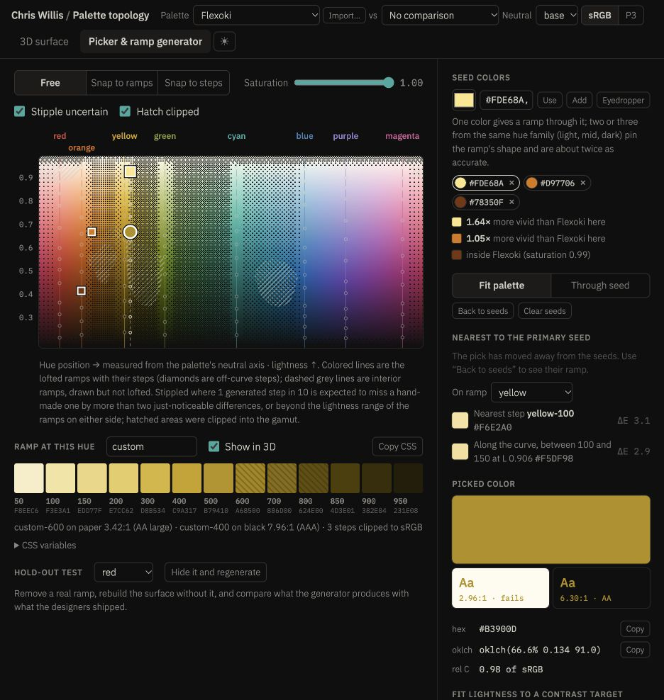

# Browser verification

Reviewed the actual local HTML served at http://127.0.0.1:8765/color-intelligence.html in the Codex in-app browser. No application source was changed.

- Initial Flexoki surface loaded and reported 104 hold-out steps. This confirms the normal startup path worked in this environment; no offline/CDN-failure test was performed.
- Accessibility tree exposed segmented choices (gamut, interpolation, snapping, contrast targets and seed mode) as text, not radio controls. This corroborates the source finding about `display: none` inputs. A full assistive-technology audit was not performed.
- Opened Picker & ramp generator and inspected its screenshot. At the observed approximately 936-pixel viewport, the input panel is to the right, the map and long explanation dominate the main area, and diagnostic experiment controls share the main task area. Mobile layout findings remain source-based; no phone viewport was tested.
- Entered `#FDE68A, #D97706, #78350F`, then selected Use with default Fit palette. The generated middle anchor was visibly labeled `500seed D6791B`.
- Clicked that exact generated button. The picked hex changed to `#B3900D`; the ramp was regenerated around the first seed's hue, seed anchors vanished, and Back to seeds appeared. This reproduces C1 in the browser, beyond the isolated engine test. The click also lost focus to the web area after rebuilding its button.

No full browser matrix, mobile device, physical P3 display, performance benchmark, storage-quota simulation, or clipboard permission test was completed. Avoid treating these observations as coverage of those areas.
