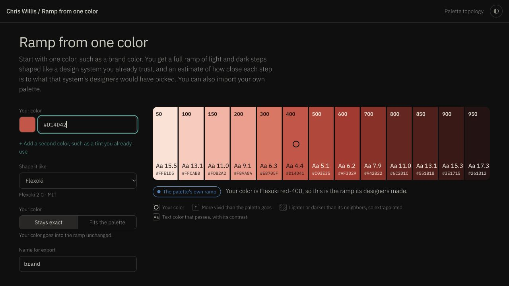

# Color ramp — consolidated technical and UX review

Reviewed 31 October–1 November 2026. Target: `color-ramp.html`, 1,563 lines. Application source unchanged.

**Status:** All five EGM phases completed: initial zoom-out, comprehension, design/structural/style critique, intermediate zoom-out, and implementation readiness. Reviewers used fresh contexts and the application was evaluated as a running tool, not an incomplete design document. Comprehension completed on its single retry after a usage-limit error. The repair backlog is not yet a fully specified implementation plan.

## Main conclusion

Repair input validity and result identity before changing the layout. This app already has an input-first mobile layout, readable stacked swatches, and native mode buttons. Its main risks are accepting invalid colors, promising exactness when output changes, losing precision on reload, saving stale import previews, and describing anchored output using a different model's calibration.

| Priority | Action | Severity | Evidence |
| --- | --- | --- | --- |
| 1 | Validate whole color values, all coordinates, alpha, and import names | Major | Executed inline-code probes and browser reproduction |
| 2 | Make “Stays exact” match actual input/output identity | Major | Executed probes and browser reproduction |
| 3 | Preserve full color values through reload | Major | Executed controller and browser reload |
| 4 | Commit current import data and report storage failures | Major | Source-traced state transitions |
| 5 | Remove unsupported confidence claims for anchored output | Major | Generation/calibration source tracing; visible default verdict |
| 6 | Complete export navigation and file-upload keyboard access | Major | Source inspection; assistive-technology verification pending |
| 7 | Keep mobile input order; shorten route from result to export | Opportunity | 320px/390px browser inspection |
| 8 | Add target-specific tests before shared-source extraction | Maintenance | Verified separate embedded implementations |

Major means a material task/result issue. No universal release blocker was established.

## 1. Invalid input can become a plausible result

At lines 411–461, the engine accepts partial syntax and ignores seed alpha. The controller at 1233 checks only the lightness coordinate. `oklch(60% nope 30)` produces finite lightness and NaN chromatic coordinates, passes the controller, and becomes the gray reference ramp. The browser URL becomes `#c-ananan.flexoki.through`. This is silent data corruption, not just an unhelpful error message.

The executable probe also accepts `rgb(1 2 3)junk`, seven-digit `#1234567`, and translucent `rgba(255,0,0,0.2)` as opaque red. Import extraction accepts `#f88 junk` by taking its color substring; inherited-looking ramp names `constructor` and `__proto__` throw. The modal catches importer exceptions, so the report does not claim those names crash the entire page.

**Repair:** Reuse the sibling's complete-syntax and finite-coordinate contract, including validation through extraction. Define an explicit transparency policy. Use own-key-safe collections. Invalid/empty edits should identify that the visible ramp belongs to the last valid input and prevent ambiguity about what Copy exports.

**Acceptance:** Malformed channels, extra text, unsupported hex lengths, alpha, valid-plus-invalid imports, and reserved-looking names. Execute this HTML's actual code; the sibling's passing tests are not coverage for this file.

## 2. “Stays exact” silently substitutes or changes seeds

At 1276–1284, the controller treats `seedMap.exact` as identity even though the engine recognizes samples within a tolerance. Flexoki input `#D14D42` is replaced by red-400 `#D14D41` and described as the user's color. The numerical difference is only ΔE OK ×100 ≈0.112; the defect is the literal/export contract, not demonstrated visible harm.

Other cases are more substantial: `#808080` returns the palette's neutral ramp with no anchor; its nearest step differs by ≈1.87. `color(display-p3 1 0 0)` shaped like Flexoki has a nearest generated step ≈6.20 away. An extreme `oklch(0.65 0.4 30)` seed differs by ≈16.35. These are numerical probes, not physical display measurements. Gamut compression can happen before the final `clipped` flag, so that flag alone does not establish seed preservation.

**Repair:** Choose and enforce the mode contract. Either preserve supported seeds in output or rename/qualify the mode and explicitly identify approximation, neutral substitution, lightness adjustment, gamut compression, and dropped second seeds. Returning an authored ramp is useful, but should be an explicit match/snap option or clearly labeled substitution.

**Additional verified defect:** Inputs `oklch(60% 0.1 30)` and `oklch(60.5% 0.1 40)` retain seed index 1 (the second input), but the result says “only the first one was used.” The engine sorts by lightness before removing near-duplicates. Derive this explanation from surviving seed identity.

**Acceptance:** Exact sample, nearby sample, gray, wide gamut, extreme lightness/chroma, and two seeds sharing an anchor in either input order. Compare original coordinates, generated anchor, displayed value, and each export format.

## 3. Reload changes higher-precision and wide-gamut input

`hashOf()` at 1423–1426 serializes every seed using 8-bit sRGB hex. `load()` at 1431–1446 then gives that hash precedence over the original input saved in localStorage.

**Reproduced:** Enter `color(display-p3 1 0 0)`, then reload. The field becomes `#FF0000`. The input-space difference is ≈4.66 in ΔE OK ×100. This affects an ordinary reload even without a Share button.

**Repair:** Use a versioned, lossless-enough state format for supported input, or avoid letting a lossy URL override locally saved exact state. Keep display hex separate from the canonical seed. Define how a URL referencing a browser-local imported palette should behave in a different browser.

**Acceptance:** Round-trip both seeds, P3 and high-precision OKLCH, mode, and palette. Handle unknown imported IDs explicitly. Recheck legacy URLs.

## 4. Import readiness can refer to old text

At 1515, editing only starts a 200 ms timer; it does not invalidate `impLast` or disable Add. At 1532–1535, Add commits `impLast` without validating current text/name. Oversized-file and read-error branches also leave prior readiness intact. `saveUser()` at 1220 suppresses storage errors although the dialog says the palette is saved locally.

This is a source-proven transition risk; the short timing window was not reproduced through browser automation.

**Repair:** Immediately invalidate readiness on every relevant edit/file attempt, validate current data synchronously at commit, cancel pending work, and make persistence success part of the transaction. Preserve the prior valid palette on failure.

The removal handler at 1482–1486 uses the same swallowed-write path. Its in-memory removal may succeed while persistence fails, so the palette can return on reload. Apply the same transaction contract to removal; this was identified by the intermediate reviewer and is source-traced, not browser-reproduced.

**Acceptance:** Preview A→edit B→immediate Add; valid→invalid; name-only edit; failed/oversized upload after success; denied storage on addition and removal. Confirm exactly what was persisted, not just what the modal displays.

## 5. Confidence claims do not validate the generated result

The reference hold-outs reconstruct ordinary full-saturation ramps with `genSteps`; this UI normally uses `genAnchors`, changing lightness and chroma and sometimes hue. Yet `generate()` attaches a band at the mean seed hue, and `renderVerdict()` says steps typically land near what the designers would make (1259–1265, 1291–1298, 1329–1343). The default example says “Mostly close” while all thirteen steps exceed the reference palette's chroma. Near-ramp taper can make the stated error arbitrarily small.

**Repair:** Describe reference-surface tests separately from anchored output. Remove individual accuracy/probability claims unless the active generation path has supporting validation. This sister app is primarily an anchored generator, so copying the sibling's eligibility function blindly could leave nearly every result ineligible; a simpler honest result explanation may fit better. A new statistical study is separate work.

**Acceptance:** One seed, two seeds, Fit, exact reference, neutral substitution, clipping/compression, extrapolation, and imported wide gaps each receive appropriate wording. Match marketing metadata, mode help, verdict, legend, methodology, and export notes.

## 6. Accessibility still needs a focused pass

Native mode buttons avoid the sibling's hidden-radio problem. However export declares tabs without a complete tab/panel relationship or arrow-key behavior (321–329, 1540–1543). Upload is a label for a `hidden` file input (363–364), leaving no ordinary focusable upload trigger. The whole regenerated ramp/verdict is a polite live region (299), which may be verbose; this requires screen-reader testing before asserting its actual effect. The fully transparent color input also needs visible-focus verification.

**Repair:** Use ordinary pressed format buttons or implement full tabs; provide a native upload button and return focus on modal close. Prefer concise committed-result announcements. Add keyboard and assistive-technology checks, including input→mode→format→copy and import.

## 7. Preserve the mobile strengths

At 320px and 390px, controls precede the ramp, and swatches become readable rows with step, hex and contrast text. These improvements are already present. Do not copy the topology tool's horizontal swatch rail just for consistency.

The export section comes after family and contrast panels. A nearby Copy action or jump link could reduce scrolling, while keeping reference panels available. Treat this as a workflow opportunity rather than a demonstrated failure. The swatches are static list items: a new per-step inspector/copy control is a product enhancement, not a repair for the topology app's old selection mutation bug.

## 8. Reuse contracts and tests before consolidating code

The two HTML pages embed related Engine and Importer implementations; hardening in the topology page is absent here. The separate `color/` package is not automatically the source owner for these pages and has a different model. Do not migrate numerical behavior as a side effect of this review.

Start with a sister-page regression harness, then adapt tested parser/import patterns. Only afterward scope a shared source/build decision that preserves standalone publishing. Avoid asserting unused engine routines are a performance problem without measurements.

## Proposed repair sequence

1. Input boundary and exact-result contract, with a target-specific test entry point.
2. Lossless state round-trip and current-input import commits, including storage failures.
3. Truthful result explanations and complete keyboard controls.
4. Small export workflow improvements; separate source-ownership proposal.

For each group, settle its explicit contract before implementation. This is a prioritized backlog, not an implementation-ready specification.

## Implementation-readiness decisions

The final reviewers identified six prerequisites, detailed in [implementation_readiness_report.md](implementation_readiness_report.md):

1. Choose the exactness contract and export behavior while input is invalid.
2. Specify lossless URL encoding, legacy compatibility, and URL/storage precedence.
3. Define ownership of asynchronous file reads and failure state for add/remove persistence.
4. Preserve family ordering (`o.band.i`) when removing unsupported confidence calculations.
5. Update Copy's selected-format lookup alongside any conversion from tabs to pressed buttons.
6. Test the actual event handlers: the diagnostic probe stops before those handlers and cannot prove import, timer, clipboard or storage integration.

These decisions should be settled within their scoped repairs. Optional Copy navigation and shared-source extraction remain deferred. The review does not authorize application changes.

## Traceability and verification limits

| Consolidated item | Reviewer source | Additional evidence |
| --- | --- | --- |
| 1 | ZO-3, CR1, CR8 | probe-results.json; malformed-input browser check |
| 2 | ZO-2, CR2–3, comprehension 2–3 | exact-mismatch.png; generation probes |
| 3 | ZO-5 follow-up hypothesis, CR6 | Promoted after controller and browser reload reproduction |
| 4 | ZO-4, CR5 | Import handler source tracing |
| 5 | ZO-1, CR4, comprehension 1 | Default verdict in browser |
| 6 | CR7 and tab nit; comprehension 4–5 | Markup/handler source; full audit pending |
| 7 | Retained strengths | mobile-layout.png at 320px and 390px |
| 8 | ZO-5, CR9 | Separate source and test entry points |

Supporting files: zoom_out_report.md, comprehension_report.md, critic_report.md, intermediate_zoom_out_report.md, improvement_plan.md, implementation_readiness_report.md, browser_verification.md, probe.cjs, probe-results.json, mobile-check.html. Run the diagnostic with `node reviews/color-ramp/probe.cjs` from the repository root. The probe executes shipped inline code using small collaborators; it is not a full browser test suite. No physical P3 display, complete assistive-technology audit, external token-consumer compatibility test, or independent calibration reproduction was performed. No app files, commits, or deployment were changed by this review.
